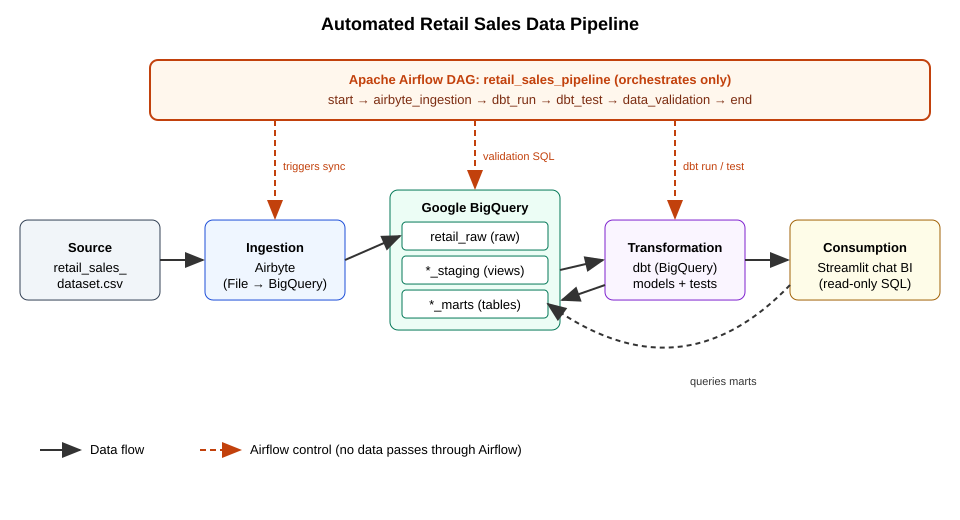

# Automated Retail Sales Data Pipeline

Data Engineering microproject: **CSV → Airbyte → BigQuery → dbt → (Airflow orchestrates) → Streamlit conversational BI**.



## 1. Business problem
Retail managers have raw transaction rows but no quick view of sales performance. This pipeline loads
the transactions into a warehouse, turns them into trusted analytical tables, and lets a manager ask
plain-English questions (category revenue, monthly trend, spend by age/gender…).

**Users:** sales / retail managers. **Questions answered:** (1) Which category earns the most revenue?
(2) How does revenue change month by month? (3) What is the average transaction value? (4) Which age
group spends most? (5) How are sales split by gender? (6) Which category sells the most units?

## 2. Source data (`data/retail_sales_dataset.csv`, never modified)
Verified with `python scripts/inspect_data.py`: 1,000 rows, 9 columns, no missing values, no duplicate
rows, unique Transaction IDs, `Total Amount = Quantity × Price per Unit` on every row.

| Column | Meaning |
|---|---|
| Transaction ID | unique transaction id |
| Date | transaction date (2023-01-01 to 2024-01-01) |
| Customer ID | customer identifier |
| Gender | Male / Female |
| Age | 18–64 |
| Product Category | Beauty, Clothing, Electronics |
| Quantity | units purchased (1–4) |
| Price per Unit | unit price (25, 30, 50, 300, 500) |
| Total Amount | transaction value |

**Findings that shape the design**
- Every Customer ID occurs once (1,000 customers, 1,000 transactions), so there are **no repeat customers**.
  "Customer purchasing patterns" is therefore modelled as spend tiers, category preference and basket size
  rather than repeat-purchase behaviour. `mart_customer_patterns` still handles repeats if data changes.
- One transaction is dated 2024-01-01, so the monthly trend has a 13th, one-row month. It is kept, not hidden.
- No region, payment or shipping columns exist, so none are used.

## 3. Design
| Layer | Object | Notes |
|---|---|---|
| Raw | `retail_raw.retail_sales` | written by Airbyte, untouched |
| Staging | `<base>_staging.stg_retail_sales` (view) | snake_case, DATE/INT/NUMERIC types, 8 validation flags, `dq_issues` text; **keeps every row** |
| Quarantine | `<base>_staging.stg_dq_rejected_records` (view) | rows failing any check (empty for this file) |
| Fact | `<base>_marts.fct_sales` | valid rows + `year_month`, `age_group`, `order_value_tier` |
| Marts | `mart_sales_kpis`, `mart_monthly_sales`, `mart_category_performance`, `mart_age_group_sales`, `mart_gender_sales`, `mart_customer_patterns`, `mart_spend_tiers` | tables read by Streamlit |

**Assumptions:** age groups 18-24 / 25-34 / 35-44 / 45-54 / 55-64; spend tiers Low <100, Medium 100-499,
High 500-999, Premium 1000+; Airbyte full-refresh overwrite (static file, idempotent reruns);
`base` = `BQ_ANALYTICS_DATASET` (default `retail_analytics`).

**dbt tests:** `unique`, `not_null`, `accepted_values` on staging, fact and marts, plus three singular tests:
`assert_total_amount_equals_quantity_times_price`, `assert_no_rows_lost_between_staging_and_facts`,
`assert_marts_reconcile_with_facts`.

## 4. Project structure
```
data/retail_sales_dataset.csv        original, untouched
scripts/                             inspect_data.py, reference_numbers.py (pandas cross-check)
dbt_project/                         models/{staging,marts}, tests/, profiles.yml (env vars only)
airflow/                             Dockerfile, docker-compose.yml, dags/retail_sales_pipeline.py
streamlit_app/                       app.py, questions.py, router.py, sql_guard.py
docs/                                architecture.svg, airbyte_setup.md
tests/test_app_logic.py              offline tests (router, SQL guard, source integrity)
.env.example  requirements.txt
```

## 5. Setup
1. **GCP:** create a project, enable the BigQuery API, create a service account with *BigQuery Data Editor*
   + *BigQuery Job User*, download its key to `secrets/gcp-key.json` (git-ignored).
2. `cp .env.example .env` and fill in `GCP_PROJECT_ID` etc. Never commit `.env` or the key.
3. `python -m venv .venv && source .venv/bin/activate && pip install -r requirements.txt`
4. `python scripts/inspect_data.py`
5. **Airbyte:** follow `docs/airbyte_setup.md`; run one sync; confirm 1,000 rows in `retail_raw.retail_sales`.
6. **dbt (manual run):**
   ```bash
   set -a; source .env; set +a
   cd dbt_project && dbt debug --profiles-dir . && dbt run --profiles-dir . && dbt test --profiles-dir .
   ```
7. **Airflow:** `cd airflow && docker compose up --build -d` → http://localhost:8080 → unpause and trigger
   `retail_sales_pipeline`. Screenshot the Graph view and a successful run.
8. **Streamlit:** `set -a; source .env; set +a; streamlit run streamlit_app/app.py`
9. **Cross-check:** `python scripts/reference_numbers.py` prints pandas totals straight from the CSV to compare
   with the dashboard.

## 6. Integration status (be explicit in your report)
| Part | Status |
|---|---|
| Airbyte → BigQuery | real Airbyte sync, triggered by Airflow's `AirbyteTriggerSyncOperator` |
| dbt run / test | real, called from Airflow with `BashOperator` |
| Validation task | real read-only SQL on BigQuery (row conservation, revenue reconciliation, optional expected count) |
| Streamlit | predefined, read-only SQL on marts + keyword router; every query passes `sql_guard` and a 100 MB billing cap. No LLM-generated SQL |
| Simplified | Airflow schedule is manual (`schedule=None`); Airbyte connection is created once in the UI, not by code |

**Not yet run end-to-end.** This was built without access to your GCP project, Airbyte or Docker, so what
was verified here is limited to: CSV integrity, Python syntax, YAML validity, and the router/SQL-guard
logic. The dbt SQL (BigQuery dialect), the DAG and the Airflow Airbyte connection have **not** been executed.
Expect to adjust (a) `raw_columns` in `dbt_project.yml` to match the column names Airbyte actually creates and
(b) the `AIRFLOW_CONN_AIRBYTE_DEFAULT` format for your Airbyte provider version. Do both while capturing your
screenshots, and describe whichever issue you hit as your "one issue and how it was resolved".

## 7. Limitations
Single static file; no incremental loads; one-purchase-per-customer limits customer analytics; keyword
routing only handles the predefined questions; local-development security (service-account key file).
